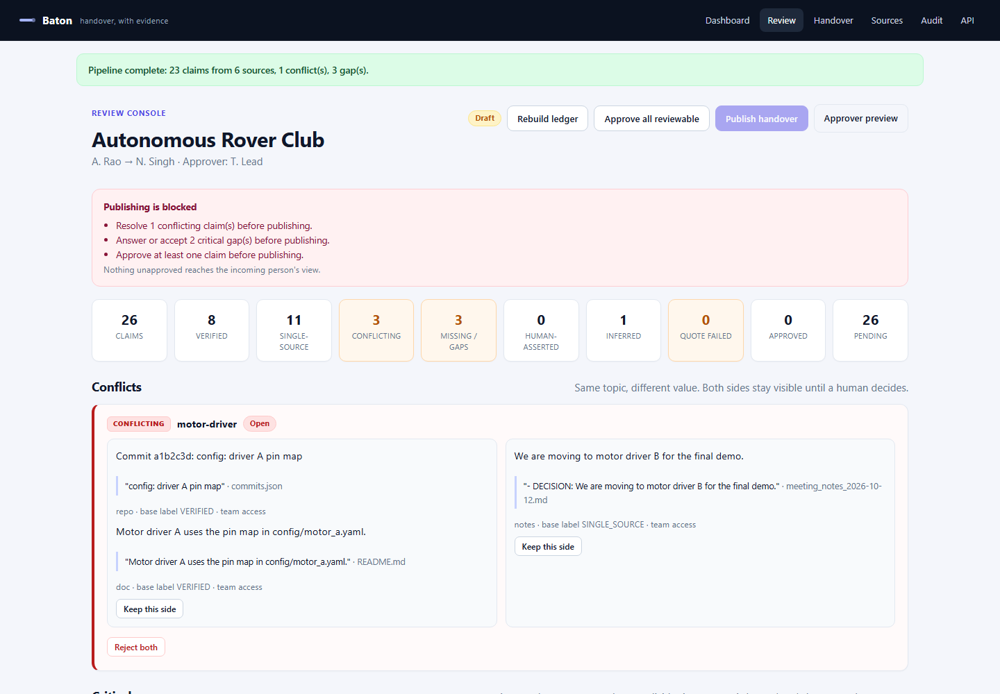
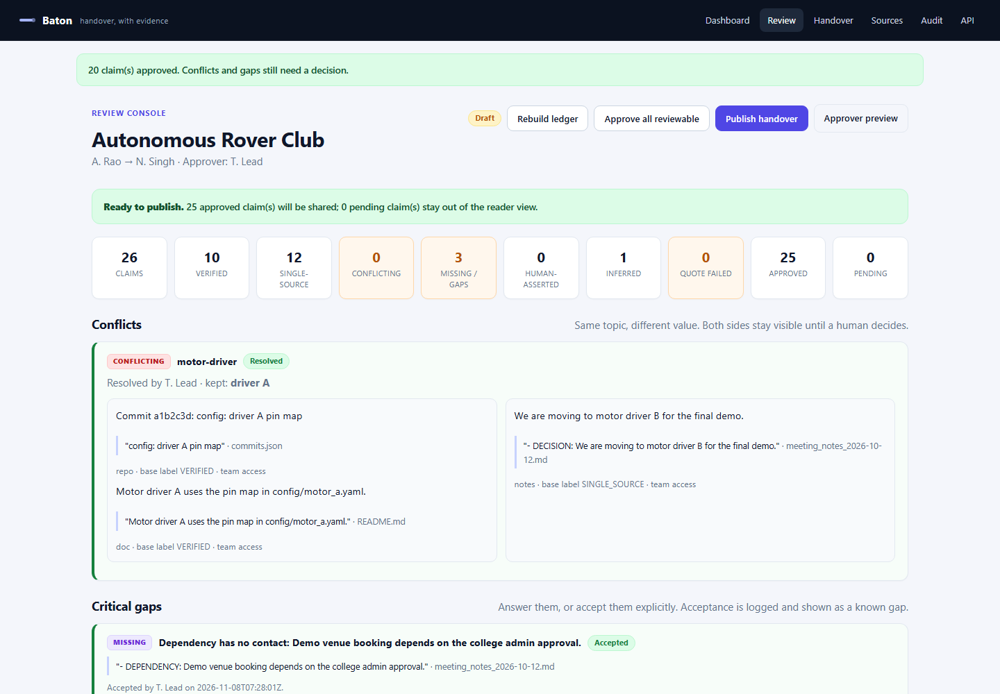
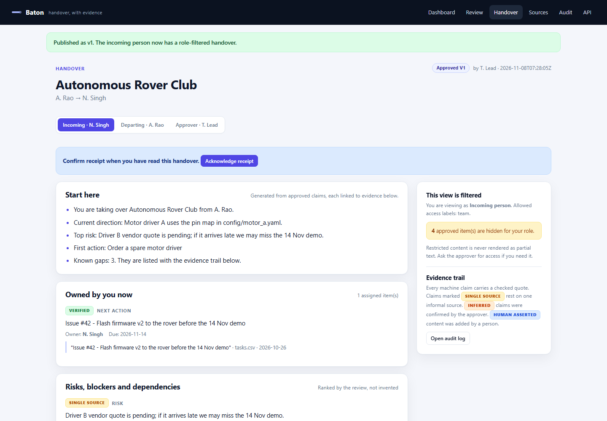

# Baton

**An evidence-linked, permission-aware knowledge handover platform**

- **Round:** Round 2 - The Build
- **Team:** ByteStorm
- **Participant:** Ritika Bhati
- **Event:** CodeFrontier Hackathon | We Code Coders
- **Date:** 8 November 2026
- **Live demo:** https://baton-t3ax.onrender.com
- **Source code:** https://github.com/Ritika-Bhati-2266/Baton


> This report covers the functional product, implementation details, changes from the Round 1 plan and the three committed Round 3 improvements. The product is a working end-to-end MVP; the limitations section is deliberately explicit.

---

## 1. Submission summary

Baton turns scattered, authorised project activity into a reviewed continuation plan for one departing member and one incoming member. The unit of trust is a single claim with a checked quote, a visible evidence label and an access label. A human resolves conflicts, answers or accepts gaps, and approves the handover before anything is shared.

| Area | What is working | How a judge can see it |
|---|---|---|
| Core workflow | Sources to reviewable, evidence-linked handover without a broken step | Run the seeded rover-club case end to end |
| Trust model | Deterministic quote verification, evidence labels, conflict and gap detection | The review console shows VERIFIED, SINGLE SOURCE, CONFLICTING and MISSING claims |
| Human control | Per-claim approve, reject, edit, conflict resolution, gap answer/accept | Every action is available in the review console and written to the audit log |
| Permissions | Source ACLs, claim inheritance, server-side role filtering | Compare the incoming, departing and approver handover views |
| Publishing | Unresolved conflicts and critical gaps block sharing | The publish button is disabled with explicit reasons until decisions are made |
| Reliability | Automated end-to-end smoke test | scripts/smoke_test.py prints SMOKE OK |


### Links

- <b>Working project:</b> https://baton-t3ax.onrender.com
- <b>Source code:</b> https://github.com/Ritika-Bhati-2266/Baton
- <b>Health check:</b> /health
- <b>API state:</b> /api/cases/rover-demo/state
- <b>OpenAPI docs:</b> /docs

### Judge's 90-second path

- Open the dashboard and click <b>Open the demo review console</b>.
- Inspect the planted motor-driver conflict, the two critical gaps and the labelled source inventory.
- Click <b>Keep this side</b> on the driver-A side, then answer or accept the critical gaps.
- Click <b>Approve all reviewable</b>, then <b>Publish handover</b>.
- The incoming person's view opens. Restricted claims are counted, not rendered; each visible claim links to its quote.
- Switch the role tabs to compare the incoming, departing and approver views, then open the Audit page.

## 2. Problem and users

When a person leaves a project, the files usually stay. What leaves is the ability to interpret them. A repository shows what the code does but not why a design was chosen. A task board shows tickets but not which ones are quietly blocked. A chat history holds a promise to a vendor, buried in a long thread.

| Knowledge that leaves | Where it hides | What goes wrong after the exit |
|---|---|---|
| Decisions and reasoning | Chat threads, meeting notes, PR comments | The successor re-opens settled debates or reverses a decision for the wrong reason |
| Unfinished work | Half-merged branches, stale tickets, personal to-do lists | Work is duplicated or silently dropped |
| Dependencies and commitments | Emails, calls, verbal promises | Deadlines and obligations are missed |
| Recurring problems and workarounds | The leaver's memory | The same failure is rediscovered expensively |
| Who to ask | Informal relationships | The successor does not know which contact or reviewer to approach |

### Users

| User | Role in a handover | Pain today | What Baton gives them |
|---|---|---|---|
| Incoming person | Takes over ownership | Manual digging; fear of missing a hidden commitment | A continuation plan with owned items, risks, open questions and first-week actions, each with sources |
| Departing member | Knows the context | No time; documents from memory; privacy worry | An auto-built draft to correct, plus targeted gap questions |
| Team lead / approver | Accountable for continuity | Cannot verify a handover or see what is missing | A review console with evidence, conflicts, gaps and per-claim decisions |
| Admin / security owner | Guards access | Fear that tools leak confidential chats or credentials | Source ACLs, redaction preview, audit log and a publish gate |

<b>Scope.</b> Baton solves the handover of one project from one departing member to one incoming member, with the consent of the people who own the sources. It deliberately does not solve company-wide knowledge search, HR offboarding or live employee monitoring.

## 3. The core idea: claims, not paragraphs

A fluent summary that invents an owner or hides a conflict looks authoritative and is more dangerous than no summary. Baton therefore stores a <b>Claim Ledger</b>: a list of typed claims (decision, owner, risk, dependency, open question, next action, blocker, recurring problem, contact). Every claim keeps the exact supporting quote, the source ID, the date and author, an evidence label and an access label.

### Evidence labels

| Label | Meaning | How Baton decides |
|---|---|---|
| VERIFIED | Quote exists and is backed well enough | Deterministic substring check passes, and the claim rests on a primary source or two independent informal sources |
| SINGLE SOURCE | Plausible but rests on one informal mention | Quote check passes, but the only support is one notes or chat source |
| CONFLICTING | Two sources disagree | Same topic key, different value; both sides stay visible |
| MISSING | Expected knowledge has no evidence | Gap rule, e.g. a task with no owner or a dependency with no contact |
| HUMAN ASSERTED | Added or changed by a person | Edits and gap answers; never shown as machine-verified |
| INFERRED | Conclusion drawn from checked quotes | Supporting quotes verified in code; reviewer confirmation required |
| QUOTE FAILED | Quote not found in the cited source | Kept out of the reader view; appears in the reviewer queue |

### Trust gates

- <b>Permissions are inherited from sources.</b> A claim takes the most restrictive access label of its evidence.
- <b>No machine claim without a checked quote.</b> The verifier is deterministic code, not a model's opinion.
- <b>Gaps are first-class output.</b> Baton reports what it could not find instead of inventing an answer.
- <b>Nothing is shared until a human approves it.</b> The incoming person sees approved claims only.

## 4. Complete workflow

| Step | What the user does | What the system does | Output |
|---|---|---|---|
| 1. Connect | Creates a handover case, picks sources and sets access labels | Read-only ingestion, stable chunking, redaction preview | Indexed, labelled source chunks |
| 2. Reconstruct | Waits for the pipeline | Deterministic extraction of typed claims with quote and source | Draft Claim Ledger |
| 3. Verify | Reviews the label dashboard | Quote match, conflict detection by topic key, gap rules | Claims with evidence labels and a gap list |
| 4. Review | Edits, rejects, approves, resolves conflicts, answers or accepts gaps | Stores reviewer identity and time; blocks publishing while blocking issues remain | Approved, versioned ledger |
| 5. Handover | Opens a role-appropriate view and acknowledges receipt | Filters claims by the reader's permissions; logs access and acknowledgement | Continuation plan plus receipt |

### Demo scenario: the rover club

A student club is handing over its autonomous-rover project from A. Rao to N. Singh. The synthetic dataset contains a README, meeting notes, a commit export, a task CSV, a leads-only chat export and a private budget note. The following failures are planted so they can be tested repeatably:

- <b>Conflict:</b> the 12 October meeting decided to move to motor driver B, but the README and the latest commit still configure driver A.
- <b>Critical gap:</b> the spare-driver task has no owner.
- <b>Critical gap:</b> the demo-venue dependency has no contact.
- <b>Non-critical gap:</b> no rollback procedure is documented.
- <b>Permission test:</b> the vendor chat is leads-only and the budget note is private.

## 5. Implemented features

### Round 2 Must features

| Feature | Status | Where it lives |
|---|---|---|
| Document, Markdown, text, CSV, JSON and PDF upload | Done | Sources page; /cases/{id}/sources/upload |
| Read-only GitHub import of public issues and commits | Done | POST /cases/{id}/sources/github |
| Typed claim extraction with quote, source, date and author | Done | app/extract.py, app/pipeline.py |
| Deterministic quote verifier | Done | app/verify.py |
| Evidence labels, conflict detection and gap rules | Done | app/verify.py |
| Review console: edit, reject and approve per claim | Done | review.html, /claims/{id}/... routes |
| Conflict resolution: keep a side or reject both | Done | POST /conflicts/{id}/resolve |
| Role-based views with source ACLs | Done | app/verify.py, handover.html |
| Secret stripping and identity pseudonymisation preview | Done | app/redaction.py, Sources page |
| Append-only audit log | Done | audit table, Audit page |
| Publishing gate for unresolved conflicts and critical gaps | Done | publish_rules, Publish button |

### Additional features delivered

- Acknowledgement of receipt, with the acknowledgement stored on the case and in the audit log.
- Human answer to a gap, stored as HUMAN ASSERTED evidence.
- Inferred claims that require explicit reviewer confirmation.
- JSON state API and automatic OpenAPI documentation.
- Docker and Render deployment configuration.
- Automated end-to-end smoke test.

### Screens in the working product



*Review console: blocking issues, evidence labels, conflicts and critical gaps.*



*After the human decisions: conflict resolved, gaps handled, claims approved.*



*Incoming-person view: filtered, evidence-linked and approved.*

## 6. Architecture and implementation

```
Browser
  |  server-rendered HTML + small JS
  v
FastAPI service
  |-- ingestion: upload / GitHub / demo seed
  |-- chunking + redaction preview
  |-- deterministic extraction (typed claims + quotes)
  |-- deterministic verifier (quote match, conflicts, gaps)
  |-- SQLite claim ledger (claims, evidence, conflicts, audit)
  |-- review actions + publish gate
  +-- role-filtered handover views
```

| Layer | Choice | Why |
|---|---|---|
| Backend | FastAPI + Python 3.12 | Typed request/response handling, automatic OpenAPI docs, strong text-processing ecosystem |
| Templates | Jinja2 | Server-rendered review and reader views with no separate build step |
| Storage | SQLite (WAL) | One deployable service for the demo; transparent ledger for judges |
| Parsing | pypdf, csv, json | PDF, task CSV and repository export ingestion |
| GitHub | httpx + GitHub REST API | Read-only public import; optional GITHUB_TOKEN for private repos |
| Deployment | Docker + Render | One command local setup and a public judge-accessible link |
| Tests | FastAPI TestClient | Full journey assertions without a browser |

### Data model

| Table | Purpose |
|---|---|
| cases | Handover case, status, published version and acknowledgement |
| sources | Authorised inputs with kind, ACL, author and source date |
| chunks | Stable source windows with character offsets |
| claims | Typed claims with value, owner, due date, event date, basis, evidence label and status |
| evidence | Quote, chunk, source and verification result |
| conflicts | Topic-level disagreement and its resolution |
| audit | Append-only record of approvals, edits, resolutions, publishing and access events |

### Key algorithms

- <b>Stable chunking:</b> sources are split into overlapping windows with permanent IDs and character offsets.
- <b>Typed extraction:</b> explicit markers, README ownership sentences, run instructions, commit/issue JSON, task CSV rows and chat exports produce claims with exact quotes.
- <b>Deterministic verification:</b> whitespace-normalised substring check against the cited source; failure downgrades the claim to QUOTE FAILED.
- <b>Conflict detection:</b> claims on the same value topic with different values are paired and marked CONFLICTING; both sides remain visible.
- <b>Gap rules:</b> an unowned task topic, a dependency with no contact and a missing rollback procedure produce MISSING claims.
- <b>Access filtering:</b> claims inherit the most restrictive source ACL; role views filter in code, never by re-prompting a model.
- <b>Publish gate:</b> open conflicts, unaccepted critical gaps and zero approved claims block publishing.
- <b>Audit:</b> every review action is appended with actor, role, action, detail and timestamp.

### API surface

| Method and path | Purpose |
|---|---|
| GET / | Dashboard and case list |
| GET /cases/{id}/review | Review console with filters |
| POST /cases/{id}/build | Run ingestion, extraction, verification, conflicts and gaps |
| POST /claims/{id}/approve, /reject, /edit | Per-claim human decisions |
| POST /conflicts/{id}/resolve | Keep one side or reject both |
| POST /claims/{id}/accept-gap, /answer-gap | Handle missing knowledge explicitly |
| POST /cases/{id}/publish | Enforce the publish gate and increment the version |
| GET /cases/{id}/handover?role=... | Role-filtered continuation plan |
| GET /cases/{id}/audit | Append-only audit trail |
| GET /api/cases/{id}/state | Machine-readable ledger state |
| GET /health | Deployment health check |

## 7. Permissions, privacy and security

| Role | Allowed access labels | What they see |
|---|---|---|
| Incoming person | team | Approved team-labelled claims only; restricted items become a count, never partial text |
| Departing member | team, leads | Team and leads-only claims; private finance notes remain hidden |
| Approver | team, leads, private | The full ledger, including private evidence, to make an informed decision |
| Admin | team, leads, private | Full ledger plus audit access |

- <b>Connecting a source does not make it shareable.</b> The upload form requires an explicit ACL.
- <b>Claim inheritance.</b> The claim takes the most restrictive label of its evidence.
- <b>Server-side filtering.</b> The incoming view is produced by code, and the automated test asserts that leads-only and private text cannot leak.
- <b>Redaction preview.</b> The Sources page shows what an external model would see after secret and identity replacement.
- <b>Secret handling.</b> GitHub tokens are used for the request only and are never stored.
- <b>Model boundary.</b> The default extractor runs locally. If an external adapter is enabled in a later round, only team-labelled text is eligible; leads and private sources stay inside the deployment.
- <b>Human control.</b> Edits and gap answers are labelled HUMAN ASSERTED and are never presented as machine-verified.
- <b>No monitoring.</b> Baton operates on one project at the moment a handover is needed.

## 8. Reliability and failure handling

| Failure case | What Baton does |
|---|---|
| Quote not found in the source | Marks the claim QUOTE FAILED; it stays out of the reader view and appears for correction or rejection |
| Two sources disagree | Marks the topic CONFLICTING and blocks publishing until a human resolves it |
| Task with no owner | Creates a critical MISSING gap; blocks publishing until answered or accepted |
| Dependency with no contact | Creates a critical MISSING gap; blocks publishing until answered or accepted |
| No rollback procedure | Creates a non-critical MISSING gap; shown as a known gap once accepted |
| No sources | Stops the pipeline with a clear message instead of producing an empty handover |
| File too large or unreadable | Rejects the upload with an explicit error; existing sources are untouched |
| GitHub import fails | Returns the HTTP status and keeps the rest of the case usable |
| Rebuild after human decisions | Requires confirmation and resets derived claims; the source inventory is preserved |
| Unapproved claims | Never included in the published handover |

## 9. Testing evidence

The end-to-end smoke test uses a temporary database, so it never touches local data. It exercises the same routes a judge uses and asserts the permission guarantee directly.

> Command: python scripts/smoke_test.py

```
SMOKE OK
  claims: 26 (approved 25)
  conflicts: 1
  gaps: 3
  labels: ['CONFLICTING', 'INFERRED', 'MISSING', 'SINGLE_SOURCE', 'VERIFIED']
  temp data: C:\Users\hp\AppData\Local\Temp\baton-smoke-9iq4pf3x
```

### What the test asserts

- The planted motor-driver conflict is detected.
- Critical gaps are detected.
- Publishing is blocked before the human decisions.
- Conflict resolution and gap handling update the publish gate.
- Publishing produces version 1.
- The incoming view does not contain leads-only or private text.
- The approver view does contain the restricted claims.
- Acknowledgement is recorded and the audit log contains the publish and acknowledge events.

## 10. Changes from the Round 1 plan

| Round 1 plan | Round 2 implementation | Why |
|---|---|---|
| Next.js + FastAPI + PostgreSQL | FastAPI + Jinja + SQLite | One deployable service; the trust model and claim schema are unchanged. A React frontend can be added without changing the ledger. |
| Claude extraction as the primary path | Deterministic local extraction, optional LLM adapter later | The demo works without a paid key; the verifier is the source of truth, and an LLM cannot grade its own work. |
| Task and chat connectors in Round 3 | Task CSV and chat export connectors already work | They were cheap to add and strengthen the permission demonstration. |
| Redis/RQ background jobs | Synchronous pipeline with visible progress | The demo corpus is small; a queue is a scale concern, not a correctness concern. |
| PostgreSQL row-level security | Application-level claim filtering plus an automated role test | The user-visible guarantee is tested: zero restricted claims in the incoming view. |
| PDF export, version diff, question flow, acknowledgement in Round 3 | Acknowledgement and gap answers are partially implemented; version diff and PDF export remain Round 3 | They are meaningful, visible additions for the next round. |

<b>Scope discipline.</b> The build focused on one complete journey rather than many shallow integrations. Two source families (documents and repository exports) plus task and chat imports are enough to demonstrate the whole workflow. Live Slack or Gmail OAuth, mobile apps and enterprise SSO remain out of scope for the event.

## 11. Three major improvements for Round 3

### 1. Departing-member question flow

<b>What:</b> critical gaps become targeted questions routed to the departing member, with structured answers, reminders and a status for each question. Answers are stored as HUMAN ASSERTED evidence and re-verified where possible.

<b>Why:</b> the current build lets the approver answer or accept a gap. Routing the question to the person who actually knows closes the tacit-knowledge gap instead of forcing the approver to guess.

<b>How measured:</b> every critical gap has an answer or an explicit acceptance; the handover shows the answer's author and timestamp.

### 2. Version diff and decision timeline across publishes

<b>What:</b> a reader-facing 'what changed since vN' view and a diff of claims added, removed, re-labelled or re-owned between handover versions, including conflict resolutions and gap decisions.

<b>Why:</b> a handover is not a one-time document. When the project moves on, the incoming person needs to see what changed without re-reading the whole ledger.

<b>How measured:</b> republishing a case produces a visible diff with counts per section and links to the changed claims.

### 3. Incoming-person feedback loop and section-level acknowledgement

<b>What:</b> the incoming person can confirm, dispute or request access per section. A dispute re-opens the claim for the approver, and the audit log captures the full loop.

<b>Why:</b> acknowledgement is currently a single receipt. Section-level feedback turns the handover into a two-way, auditable transition rather than a broadcast.

<b>How measured:</b> a disputed section returns to the approver queue, and the audit log shows the dispute, the correction and the re-acknowledgement.

## 12. Demo script for judges

- Open the dashboard. The demo case shows 6 sources and 0 claims before the first build.
- Open the review console and click <b>Rebuild ledger</b>.
- Inspect the conflict card: meeting notes say driver B; README and commit say driver A.
- Click <b>Keep this side</b> on the driver-A group.
- Answer the spare-driver ownership gap with a short human answer; accept or answer the demo-venue dependency gap.
- Click <b>Approve all reviewable</b>. The publish banner turns green.
- Click <b>Publish handover</b>. The incoming view opens as approved v1.
- Note the restricted-item count on the right. The incoming person cannot see the leads-only chat or the private budget note.
- Switch to the approver role to see the restricted claims. Open the Audit page to see every decision.
- Click <b>Acknowledge receipt</b> as the incoming person; the acknowledgement appears in the audit log.

## 13. Known limitations and future scope

- <b>Authentication is simulated with role tabs</b> so judges can open every link without signing in. Production would bind roles to an authenticated session or SSO.
- <b>SQLite is single-node.</b> A multi-user deployment should move the ledger to PostgreSQL.
- <b>The deterministic extractor is strongest on structured notes and exports.</b> Free prose needs the optional LLM adapter or careful marker use.
- <b>The GitHub connector is read-only</b> and capped at 20 issues and 20 commits per import.
- <b>PDF extraction depends on a text layer.</b> Scanned PDFs need OCR, which is future scope.
- <b>The free hosting filesystem is ephemeral.</b> The synthetic demo reseeds after a restart; a persistent volume is needed for real data.
- <b>No email or notification delivery yet.</b> The departing-member question flow is a Round 3 improvement.
- <b>Future scope:</b> PostgreSQL and row-level security, SSO, live Slack/Drive/Jira connectors, continuous ledger mode, on-premise local models, role templates and a grounding evaluation suite.

## 14. Responsible design and disclosures

- All demonstration data is synthetic. No confidential workplace material is used.
- Connectors require explicit consent from the source owner; the upload screen warns against confidential material.
- Restricted claims are filtered server-side and rendered only as a count.
- Human edits and gap answers are never presented as machine-verified.
- The audit log records who approved, edited, resolved, published and acknowledged.
- The product does not monitor employees; it operates on one project at the moment a handover is needed.
- <b>AI assistance disclosure:</b> an AI assistant was used to help structure, draft and revise the plan and the implementation. The verifier, permission tests and demo behaviour are executable and can be inspected in the repository.
- <b>Third-party libraries:</b> FastAPI, Uvicorn, Jinja2, pypdf, httpx, python-docx and reportlab (report generation only). No product code existed before the build window.

## 15. Team and contribution

| Name | Role | Contribution |
|---|---|---|
| Ritika Bhati | Team lead; backend, verification, frontend, product and QA | Claim schema, deterministic extractor and verifier, conflict and gap rules, FastAPI routes, SQLite ledger, permission filtering, review console, reader view, synthetic dataset, tests, documentation and demo |

Team name: ByteStorm. Solo submission for CodeFrontier Hackathon, Round 2.

---

## Appendix A. Repository structure

```
Baton/  (repository root)
  app/
    main.py          FastAPI routes and pages
    db.py            SQLite schema and helpers
    seed.py          synthetic rover-club dataset
    extract.py       typed claim extraction
    verify.py        labels, conflicts, gaps, publish gate
    pipeline.py      chunking and build orchestration
    redaction.py     secret stripping and pseudonymisation preview
    templates/       dashboard, review, sources, handover, audit
    static/          app.css, app.js
  scripts/
    smoke_test.py    end-to-end test
    make_round2_report.py
  requirements.txt
  Dockerfile
  render.yaml
  run.ps1 / run.sh
  README.md
```

## Appendix B. Run and test

```
Windows:
  cd Baton
  .\run.ps1

macOS / Linux:
  cd Baton
  sh run.sh

Docker:
  docker build -t baton .
  docker run --rm -p 8000:8000 baton

Test:
  python scripts/smoke_test.py
```
